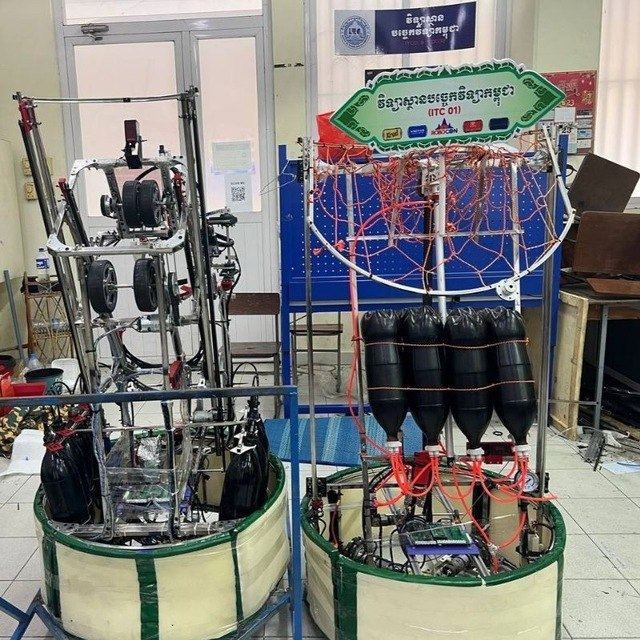
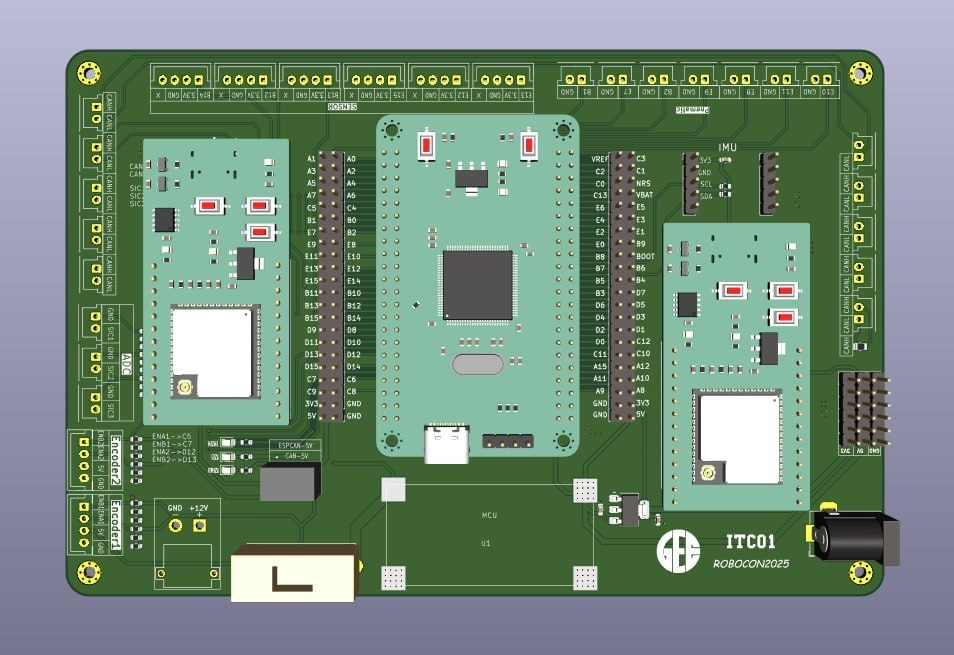
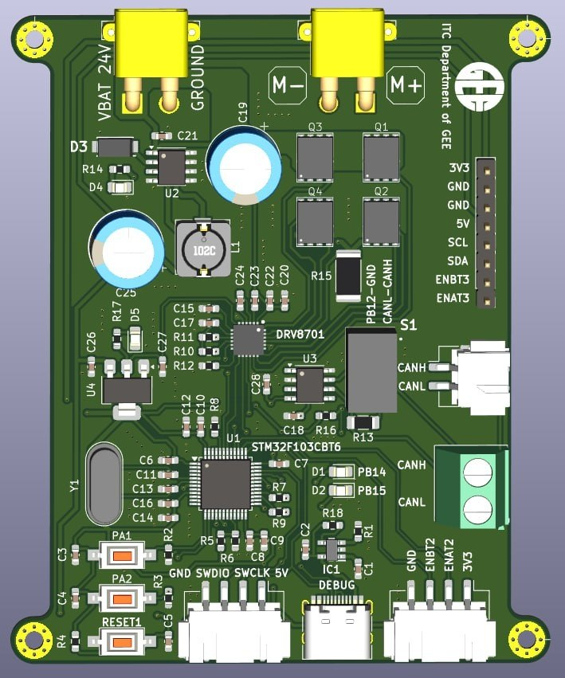
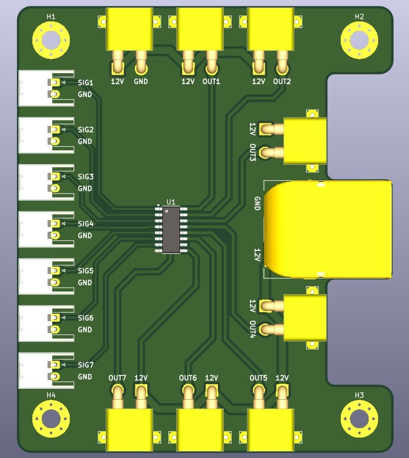
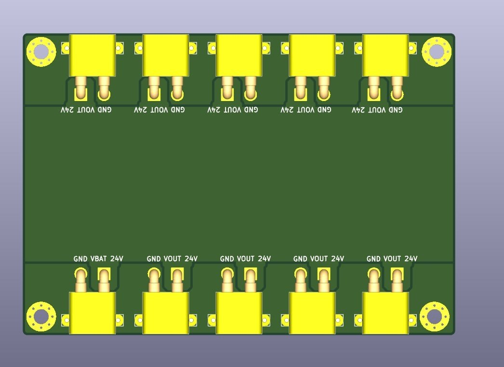
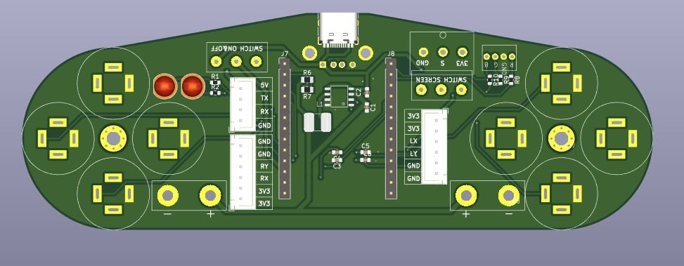

# Experiences

# Work Experiences

<h3>STEAMING Cambodia</h3>

<b>Date:</b> Nov 2026 to Feb 2027

<b>Position:</b> Robotics Tutor

<b>Contribution:</b>

<ul>
<li>Teaching micro:bit programming to young students in the Micro:Bit Innovators Program, and guiding them through projects such as a smart parking barrier, a water tank level alert, a smart plant helper and a manually controlled robot.</li>
<li>Teaching a Robotics and IoT class with the ESP32 for high school seniors and university students, and guiding them through projects such as a remote-controlled differential-drive robot and a solar tracking system.</li>
</ul>

<b>Result:</b> Built the 12-session Micro:Bit Innovators Program, including all course documents and the promotional video, and gained experience teaching Robotics and IoT with the ESP32 to high school seniors and university students.

<h3>SNKRP</h3>

<b>Date:</b> Aug 2026 to Oct 2026

<b>Position:</b> Relay Protection Testing Engineer

<b>Contribution:</b>

<ul>
<li>Worked on power grid systems and relay protection at substation level with EDC, both on-site and in the provinces.</li>
<li>Worked with NR and Siemens relay and protection panels covering 22kV feeders, incoming/outgoing PT, bus coupler, bus riser, and 230kV transformer, busbar and line protection, and read AutoCAD drawings from NR, XD, HEIG and CCPG.</li>
<li>Supported engineers in testing relay protection systems using the OMICRON CMC 356.</li>
</ul>

<b>Result:</b> Helped verify correct relay operation and prepared test reports for EDC.

<h3>SeksaaTech Academy</h3>

<b>Date:</b> Jun 2026 to Aug 2026

<b>Position:</b> Robotics Tutor

<b>Contribution:</b>

<ul>
<li>Taught electronics and micro:bit programming, simplifying complex technical concepts into engaging lessons for young learners.</li>
<li>Created video lessons and learning materials on micro:bit programming and Tinkercad circuit design, combining simulation with hands-on experiments.</li>
</ul>

<b>Result:</b> Students could learn electronics and programming at their own pace with the video lessons and materials.

<h3>Happy Sprouts</h3>

<b>Date:</b> Sep 2025 to Jul 2026

<b>Position:</b> Robotics Engineer (part-time)

<b>Contribution:</b>

<ul>
<li>Designed and programmed the electrical system for a 6-DOF robot arm, combining 2 DOF for horizontal and vertical linear movement with a 4 DOF SCARA arm mounted on the linear axes.</li>
<li>Integrated ROS 2 with STM32 microcontrollers to read encoder and sensor data, and configured MKS stepper motor drivers for NEMA17 and NEMA23 motors over CAN bus.</li>
<li>Managed the full electrical and electronic system, balancing performance with low power consumption, and trained a custom mushroom detection dataset.</li>
</ul>

<b>Result:</b> Delivered a working prototype in which the gantry and SCARA arm move and operate as designed. Automatic mushroom harvesting is not yet complete.

<h3>Startec Dynamics (Calypso Motors)</h3>

<b>Date:</b> Jun 2025 to Sep 2025

<b>Position:</b> Engineering Intern

<b>Contribution:</b>

<ul>
<li>Designed and built a motorbike status tracking system using GPS, an IMU and an ESP32, tracking real-time location and detecting starting, stopping and possible accidents from changes in movement.</li>
<li>Assisted senior engineers in assembling motorbike parts.</li>
<li>Deployed code from the development team onto the motorbikes, tested it, and reported the results back to the technical and bike development teams.</li>
</ul>

<b>Result:</b> Through repeated test and feedback cycles, helped identify and resolve bugs until each issue was solved.

<h3>ABU Robocon 2025, ITC01 Team (GEE Lab, ITC)</h3>

<b>Date:</b> 2025

<b>Position:</b> Team Leader

<b>Contribution:</b>

<ul>
<li>Led the team for a two-robot project, coordinating the mechanical, electronics and software teams, and directed robot design, system integration and testing.</li>
<li>Programmed both robots together with a teammate.</li>
<li>Assisted in designing DRV-based motor driver PCBs, main controller shield boards for both robots, and a pneumatic control PCB for solenoid valve actuation, and contributed to the integration and testing of the custom CAN-based electronics system.</li>
</ul>

<b>Result:</b> Both robots were ready to play within the 800 mm footprint and 50 kg weight constraints. The first robot could dribble, block, pass and shoot, and the second robot could shoot, block and receive.

<iframe src="https://www.youtube-nocookie.com/embed/PEyFnWSA1Q8" title="ABU Robocon 2025, ITC01 team demo" style="width: 100%; aspect-ratio: 16 / 9; border: 0; border-radius: 8px;" allow="accelerometer; clipboard-write; encrypted-media; gyroscope; picture-in-picture; web-share" allowfullscreen loading="lazy"></iframe>
<iframe src="https://www.youtube-nocookie.com/embed/fH2yQHRbGQ4" title="ABU Robocon 2025, ITC01 test shot" style="width: 100%; max-width: 315px; aspect-ratio: 9 / 16; border: 0; border-radius: 8px;" allow="accelerometer; clipboard-write; encrypted-media; gyroscope; picture-in-picture; web-share" allowfullscreen loading="lazy"></iframe>

<h3>Robocon 2024, ITC02 Team (DCLab, ITC)</h3>

<b>Date:</b> 2024

<b>Position:</b> Electronics Team Member

<b>Contribution:</b>

<ul>
<li>Assisted with PCB assembly, soldering, robot wiring and hardware integration.</li>
</ul>

<b>Result:</b> Supported the development and testing of the robots' electrical systems for the competition.

<h3>AI Farm</h3>

<b>Date:</b> Aug 2023 to Oct 2023

<b>Position:</b> Engineering Intern

<b>Contribution:</b>

<ul>
<li>Designed closed-loop stepper motor control for a robot arm on STM32, using PID with encoder feedback.</li>
</ul>

