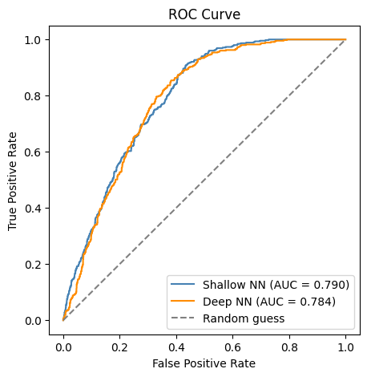
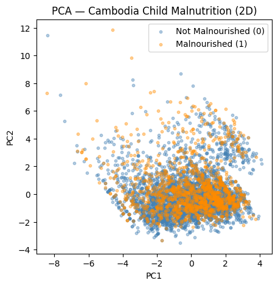
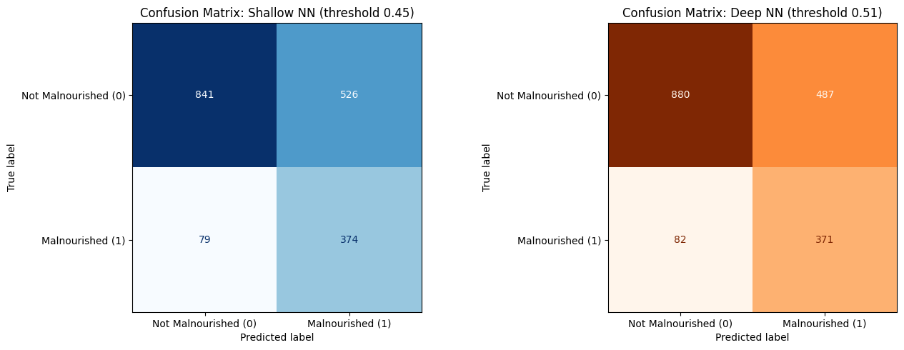

# Projects

## Active Projects

<h3>Shared Control Teleoperation of a Mobile Robot under Communication Delay</h3>

Independent research

A mobile robot driven remotely by a human, where the robot helps avoid collisions while the commands and sensor data arrive late. The project builds on the paper "Collision Avoidance with the Novel Advanced Shared Smooth Control in Teleoperated Mobile Robot Vehicles" (Electronics, 2026) and extends its shared control approach to handle delay.

<b>Status:</b> In progress

<b>Date:</b> 2026

<b>Hardware:</b> Simulation only, driven with a PS4 controller

<b>Software:</b> ROS 2, Gazebo, simulated 3D LiDAR

<b>Results:</b> Not yet, project in progress

<h3>DIY Dual-Axis Solar Tracker with Energy Monitoring</h3>

STEAMING Cambodia

A small solar panel that turns to face the sun on two axes. Four light sensors compare the light from each side and two servo motors move the panel toward the brighter side, while the ESP32 measures the panel's voltage, current and power and shows them on a web dashboard.

<b>Status:</b> In progress

<b>Date:</b> 2026

<b>Hardware:</b> ESP32, 2 MG996R servo motors (pan and tilt), 4 LDR light sensors with 10 kΩ resistors, small 6 V solar panel, INA219 current and voltage sensor, TP4056 charger with an 18650 battery, 5 V buck converter for the servos

<b>Software:</b> Arduino IDE (C++), ESP32Servo library, Adafruit INA219 library, ESP32 Wi-Fi web dashboard

<b>Results:</b> Not yet, project in progress

## Mobile Robots

<h3>Lookahead-Based Path Tracking for a Three-Wheel Swerve-Drive Robot</h3>

DCLab

Designed and integrated a lookahead-based path tracking system for a three-wheel swerve-drive robot, so it can follow different paths with one set of parameters instead of retuning PID for x, y and heading.

<b>Status:</b> Done (paper under review at RAAI 2026)

<b>Date:</b> 2025

<b>Hardware:</b> Three-wheel swerve-drive robot with brushed DC drive and steering motors, three smart DC motor drivers over CAN bus, Livox Mid-360 3D LiDAR with built-in IMU, onboard laptop (MSI Cyborg 15), 12 V and 24 V LiPo batteries

<b>Software:</b> Ubuntu 22.04, ROS 2 Humble, C++, FAST-LIO2, RViz2

<b>Results:</b>

<ul>
<li>RMS cross-track error of 0.77, 0.80, 1.09 and 2.89 cm on square, circle, triangle and star paths, at up to 1.5 m/s.</li>
<li>RMS heading error below 0.22 rad on the square, circle and triangle paths.</li>
<li>One fixed set of parameters for all four paths, with no retuning.</li>
</ul>

<iframe src="https://www.youtube-nocookie.com/embed/0R4cwXsbjWk" title="Look-ahead based path tracking" style="width: 100%; aspect-ratio: 16 / 9; border: 0; border-radius: 8px;" allow="accelerometer; clipboard-write; encrypted-media; gyroscope; picture-in-picture; web-share" allowfullscreen loading="lazy"></iframe>
<iframe src="https://www.youtube-nocookie.com/embed/mZaEWtkU5vU" title="Square path" style="width: 100%; max-width: 315px; aspect-ratio: 9 / 16; border: 0; border-radius: 8px;" allow="accelerometer; clipboard-write; encrypted-media; gyroscope; picture-in-picture; web-share" allowfullscreen loading="lazy"></iframe>
<iframe src="https://www.youtube-nocookie.com/embed/yoF-kFjS9Wk" title="Circle path" style="width: 100%; max-width: 315px; aspect-ratio: 9 / 16; border: 0; border-radius: 8px;" allow="accelerometer; clipboard-write; encrypted-media; gyroscope; picture-in-picture; web-share" allowfullscreen loading="lazy"></iframe>
<iframe src="https://www.youtube-nocookie.com/embed/zy5cdmMZF4w" title="Triangle path" style="width: 100%; max-width: 315px; aspect-ratio: 9 / 16; border: 0; border-radius: 8px;" allow="accelerometer; clipboard-write; encrypted-media; gyroscope; picture-in-picture; web-share" allowfullscreen loading="lazy"></iframe>
<iframe src="https://www.youtube-nocookie.com/embed/rwnqj0EVlnU" title="Star path" style="width: 100%; max-width: 315px; aspect-ratio: 9 / 16; border: 0; border-radius: 8px;" allow="accelerometer; clipboard-write; encrypted-media; gyroscope; picture-in-picture; web-share" allowfullscreen loading="lazy"></iframe>

<h3>Autonomous Indoor Food Delivery Robot (Thesis)</h3>

DCLab

Built a differential-drive delivery robot from scratch together with Te Tikea. The robot maps a classroom, localizes, drives to a goal and replans around obstacles that were not in the map.

<b>Status:</b> Done (thesis defended)

<b>Date:</b> 2026

<b>Hardware:</b> Differential-drive base with hub servo motors, ZLAC8015D motor driver (CANopen), NVIDIA Jetson Orin Nano Super, RPLIDAR A1, Intel RealSense D435, Yahboom IMU, LiPo 6S 10 Ah battery, 7-inch display

<b>Software:</b> Ubuntu 22.04, ROS 2 Humble, Nav2, SLAM Toolbox, AMCL, SMAC 2D planner, Vector Pursuit controller, Gazebo Classic

<b>Results:</b>

<ul>
<li>Reached the goal in all 10 trials (5 without and 5 with added obstacles), with no collisions.</li>
<li>Mean position error of 0.256 m without obstacles and 0.260 m with obstacles.</li>
<li>Mean heading error of 11.56° without obstacles and 12.48° with obstacles.</li>
</ul>

<iframe src="https://www.youtube-nocookie.com/embed/rQ5fnVoLUaU" title="Autonomous Food Delivery Robot - Full navigation inside a classroom" style="width: 100%; aspect-ratio: 16 / 9; border: 0; border-radius: 8px;" allow="accelerometer; clipboard-write; encrypted-media; gyroscope; picture-in-picture; web-share" allowfullscreen loading="lazy"></iframe>
<iframe src="https://www.youtube-nocookie.com/embed/7Au0h4lYpns" title="Autonomous Food Delivery Robot" style="width: 100%; aspect-ratio: 16 / 9; border: 0; border-radius: 8px;" allow="accelerometer; clipboard-write; encrypted-media; gyroscope; picture-in-picture; web-share" allowfullscreen loading="lazy"></iframe>
<iframe src="https://www.youtube-nocookie.com/embed/6is34BcX-9I" title="Autonomous Food Delivery Robot - Simulation" style="width: 100%; aspect-ratio: 16 / 9; border: 0; border-radius: 8px;" allow="accelerometer; clipboard-write; encrypted-media; gyroscope; picture-in-picture; web-share" allowfullscreen loading="lazy"></iframe>
<iframe src="https://www.youtube-nocookie.com/embed/9ClcoE87dZw" title="Autonomous Food Delivery Robot" style="width: 100%; max-width: 315px; aspect-ratio: 9 / 16; border: 0; border-radius: 8px;" allow="accelerometer; clipboard-write; encrypted-media; gyroscope; picture-in-picture; web-share" allowfullscreen loading="lazy"></iframe>
<iframe src="https://www.youtube-nocookie.com/embed/RdwP9cqwr-o" title="Autonomous Food Delivery Robot" style="width: 100%; max-width: 315px; aspect-ratio: 9 / 16; border: 0; border-radius: 8px;" allow="accelerometer; clipboard-write; encrypted-media; gyroscope; picture-in-picture; web-share" allowfullscreen loading="lazy"></iframe>

## Robot Arms

<h3>Face Tracking Teleoperation with SO-ARM101</h3>

Exchange semester, France

Led the project as Scrum Master. A single webcam tracks the face to control the arm hands-free: head yaw moves the base, head pitch moves the wrist, and mouth opening controls the gripper.

<b>Status:</b> Done

<b>Date:</b> 2025

<b>Hardware:</b> SO-ARM101 6-DOF robot arm, Feetech STS3215 servos, webcam

<b>Software:</b> Ubuntu 22.04, Python, OpenCV, dlib

<b>Results:</b>

<ul>
<li>Three joints (base, wrist and gripper) controlled by the face at 60 Hz.</li>
<li>A deadband removes the ±2.0 jitter in head yaw and pitch, so the arm stays still when the head is still.</li>
</ul>

<iframe src="https://www.youtube-nocookie.com/embed/ULV6JxhXbB4" title="Face tracking teleoperation with SO-ARM101" style="width: 100%; max-width: 315px; aspect-ratio: 9 / 16; border: 0; border-radius: 8px;" allow="accelerometer; clipboard-write; encrypted-media; gyroscope; picture-in-picture; web-share" allowfullscreen loading="lazy"></iframe>

## Industrial Automation

<h3>Sequence Variation System with an ABB Robot Arm</h3>

The robot picks objects one by one from a 4x4 grid and places them at Place A and Place B in turn, in a continuous loop. After every Place B cycle, it sends a done signal to the conveyor PLC.

<b>Status:</b> Done

<b>Date:</b> 2026

<b>Hardware:</b> ABB industrial robot arm, vacuum gripper with a pressure sensor, conveyor controlled by a PLC

<b>Software:</b> ABB RobotStudio, RAPID

<b>Results:</b>

<ul>
<li>All 16 grid positions are calculated from one taught target with offsets of 50 mm per column and 40 mm per row, so only one pick point had to be taught.</li>
<li>The robot alternates strictly between Place A and Place B every cycle, using the cycle counter (even or odd).</li>
<li>Fixed a problem where the robot sometimes lifted before the vacuum had gripped the object, by waiting for the pressure sensor signal before moving.</li>
</ul>

<iframe src="https://www.youtube-nocookie.com/embed/36Xstqjolxg" title="Industrial ABB Robot Arm - Pick and place" style="width: 100%; aspect-ratio: 16 / 9; border: 0; border-radius: 8px;" allow="accelerometer; clipboard-write; encrypted-media; gyroscope; picture-in-picture; web-share" allowfullscreen loading="lazy"></iframe>

<h3>Conveyor Sorting System with PLC and HMI</h3>

A conveyor sorting system controlled by a PLC and operated from an HMI panel.

<b>Status:</b> Done

<b>Date:</b> 2026

<b>Hardware:</b> Conveyor, Siemens PLC, HMI panel

<b>Software:</b> Siemens TIA Portal V18

<iframe src="https://www.youtube-nocookie.com/embed/8rvLOJjhovw" title="Conveyor Sorting System with PLC and HMI" style="width: 100%; aspect-ratio: 16 / 9; border: 0; border-radius: 8px;" allow="accelerometer; clipboard-write; encrypted-media; gyroscope; picture-in-picture; web-share" allowfullscreen loading="lazy"></iframe>

## Machine Learning

<h3>Cambodia Child Malnutrition Prediction with Machine Learning</h3>

Predicts whether a Cambodian household has child malnutrition from 17 household indicators, such as access to electricity, clean water and sanitation, education, region and urban or rural location, using the Cambodia Demographic and Health Survey (DHS) data of 9,099 households. The data was split 60/20/20 for training, validation and testing, and the models were trained with class weights and early stopping because only about 25% of households are malnourished. Two supervised neural networks were compared with unsupervised K-Means clustering, with PCA to visualize the data.

<b>Status:</b> Done

<b>Date:</b> 2025

<b>Hardware:</b> Google Colab GPU

<b>Software:</b> Python, PyTorch, scikit-learn, NumPy, pandas, Matplotlib

<b>Data:</b> Cambodia Demographic and Health Survey (DHS) household data, preprocessed version from Kaggle (<a href="https://www.kaggle.com/datasets/taniaj/cambodia-preprocessed">taniaj/cambodia-preprocessed</a>), original survey by <a href="https://dhsprogram.com/">The DHS Program</a>

<b>Results:</b>

<ul>
<li>Deep neural network (3 hidden layers) with a tuned threshold: found 82% of malnourished households, F1 0.566, ROC-AUC 0.784.</li>
<li>Shallow neural network (2 hidden layers): found 76% of malnourished households, F1 0.543, ROC-AUC 0.790.</li>
<li>K-Means clustering: balanced accuracy 0.50 and Adjusted Rand Index 0.003, so the clusters did not match malnutrition without labels.</li>
</ul>

